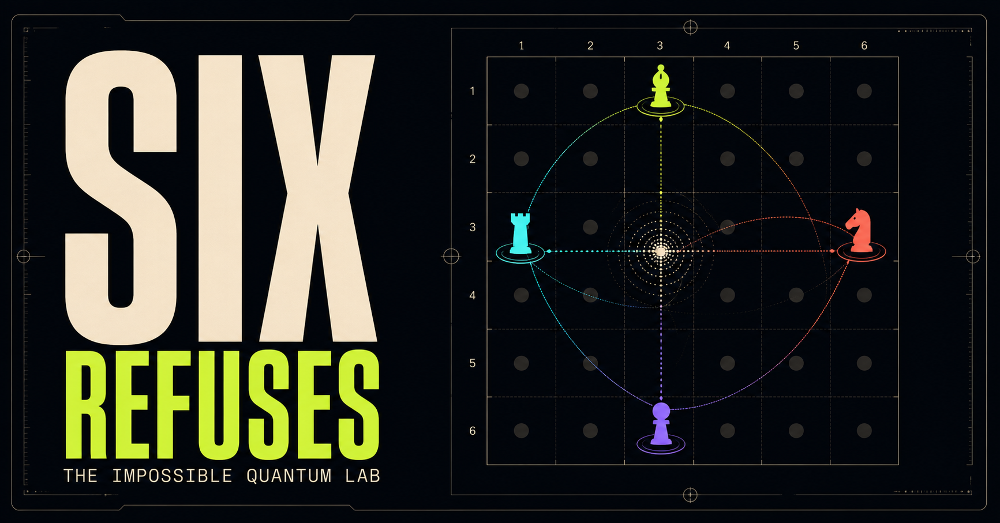

# The Impossible Quantum Lab

**Euler’s 36 Officers Quantum Lab — quantum mechanics from first principles
through one classically impossible puzzle.**

[Open the live lab](https://six-refuses.eduardofabianbergel.chatgpt.site)

Six Refuses is an interactive learning experience for anyone who is highly
curious and wants rigorous quantum intuition without starting from slogans. It
begins with a classical arrangement that cannot be completed and ends with the
published Golden QOLS(6): 36 exact quantum states whose coherence makes a deeper
quantum version of the structure possible.

## Who it is for

The primary learner is anyone who is highly curious, comfortable with basic
algebra, and willing to think carefully. No calculus or previous quantum
mechanics is required. The notation is real quantum notation, introduced only
after an interaction gives it something concrete to describe.

The lab is also useful to educators and self-taught learners looking for an
operational, mathematically honest introduction to amplitudes, interference,
tensor products, entanglement, orthogonality, and perfect tensors.

## How the lab teaches

Six Refuses treats the learner as a researcher, not a quiz-taker.

- **Predict before revealing.** Experiments ask the learner to commit before
  showing an outcome.
- **One puzzle, revisited deeply.** Every idea returns to four labels: row,
  column, rank, and regiment.
- **Metaphors must cash out mathematically.** Relative phase becomes real when
  recombination exposes it.
- **Failure is an instrument.** Erasing phases preserves every basis
  probability while destroying the quantum square.
- **Intuition, mechanism, proof.** Visual explanations lead into equations and
  exact invariants instead of replacing them.
- **Interpretation is labeled honestly.** Operational predictions are kept
  separate from claims about what quantum states “really are.”

## The experiments

| Lab | Learner investigation |
| --- | --- |
| The rulebook | Meet Euler’s four labels and the classical/quantum distinction. |
| Classical prison | Swap officers in a solved 3×3 square and an optimal cost-2 6×6 near-solution. |
| Amplitude engine | Build a two-state vector, sample Born probabilities, rotate relative phase, recombine paths, and discover orthogonality. |
| Tensor products and entanglement | Compare a product coefficient matrix with a Bell state and run an idealized CHSH-game Monte Carlo. |
| Golden quantum square | Inspect and measure the 36 published states, erase phases, scan marginals, examine the golden amplitudes, and view the three perfect-tensor cuts. |
| Research frontier | Explore why φ appears, inequivalent QOLS(6) solutions, and links to quantum error correction. |

This is a focused conceptual laboratory, not a complete quantum-mechanics
course or a hardware-level quantum circuit simulator. The Bell experiment
samples ideal theoretical distributions. The Golden Square uses the actual
analytic state data.

## Run locally

Requirements: Node.js 22.13 or newer and npm.

    git clone https://github.com/ebergel/euler-36-officers-quantum-lab.git
    cd euler-36-officers-quantum-lab
    npm ci
    npm run dev

Open the local URL printed by the development server.

No database, account, API key, or environment variable is required.

The `"private": true` flag in `package.json` only prevents accidental
publication to the npm registry. It does not make the GitHub repository or the
deployed app private; repository visibility is controlled by GitHub.

## Quality checks

    npm run lint
    npm run typecheck
    npm run build
    npm test

The test suite performs a production build and then checks:

- server-rendered content and metadata;
- the exact count and structure of the 36 quantum officers;
- normalization and all 630 pairwise orthogonality relations;
- every row/column marginal;
- all four row/column partial-trace identity families;
- the optimal classical near-square’s uniqueness and cost-2 invariant.

## Project map

| Path | Purpose |
| --- | --- |
| <code>app/page.tsx</code> | Learning sequence, simulations, and interaction state |
| <code>app/quantum-data.ts</code> | Exact 36-state Golden QOLS(6) transcription |
| <code>app/globals.css</code> | Visual system, responsive layouts, focus treatment, and reduced-motion support |
| <code>tests/</code> | Render checks and deterministic mathematical invariant tests |
| <code>docs/SCIENCE.md</code> | Scientific scope, provenance, equations, and accuracy guardrails |
| <code>docs/TEACHING.md</code> | Learning design and contributor rubric |
| <code>docs/ARCHITECTURE.md</code> | Runtime structure and extension points |
| <code>docs/DEPLOYMENT.md</code> | Fork and deployment guidance |
| <code>worker/</code>, <code>build/</code>, <code>vite.config.ts</code> | Vinext and Cloudflare-compatible hosting layer |

The interface is intentionally local-first and stateless. Learner interactions
remain in browser memory and are not collected or transmitted.

Deployment guidance for forks is in
[docs/DEPLOYMENT.md](docs/DEPLOYMENT.md).

## Scientific provenance

The 36 states in <code>app/quantum-data.ts</code> are transcribed from Appendix
B of the explanatory paper, including the phase convention
ω = exp(iπ/10). The invariant tests independently verify the construction to
floating-point precision.

Primary references:

- K. Życzkowski et al.,
  [9 × 4 = 6 × 6: Understanding the quantum solution to Euler’s problem of 36 officers](https://arxiv.org/abs/2204.06800)
- S. A. Rather et al.,
  [Thirty-six entangled officers of Euler: Quantum solution to a classically impossible problem](https://arxiv.org/abs/2104.05122)
- Up and Atom,
  [Quantum Physics Found a Loophole in an IMPOSSIBLE Math Problem](https://www.youtube.com/watch?v=SCI8g6EinAo)

The repository does not redistribute the local paper PDF or video transcript
used during development. See [docs/SCIENCE.md](docs/SCIENCE.md) for the exact
claims the app makes and the simplifications it avoids.

## Contributing

Contributions are welcome. Start with [CONTRIBUTING.md](CONTRIBUTING.md) and
the [teaching rubric](docs/TEACHING.md). New scientific interactions should
include a manipulable hypothesis, an observable consequence, the underlying
invariant, an explicit scope note, accessible controls, and deterministic
tests.

Please use the issue templates for bugs and proposals. By participating, you
agree to follow the [Code of Conduct](CODE_OF_CONDUCT.md).

## Citation

If this project helps your teaching or research, cite the software metadata in
[CITATION.cff](CITATION.cff) and the two primary papers above.

## License

Original source code and educational writing are available under the
[MIT License](LICENSE). The adapted Golden QOLS(6) state-table data retain the
source paper’s CC BY 4.0 license. The generated social-preview image and other
provenance details are documented in
[THIRD_PARTY_NOTICES.md](THIRD_PARTY_NOTICES.md). Linked papers, video, fonts,
and dependencies remain under their respective terms.
